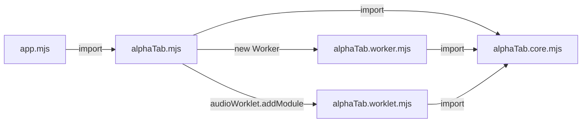

import Tabs from '@theme/Tabs';
import TabItem from '@theme/TabItem';
import { SinceBadge } from '@site/src/components/SinceBadge';

<SinceBadge since="1.3.0" />

Add the alphaTab plugin to your WebPack 5 config:

```js
import { AlphaTabWebPackPlugin } from '@coderline/alphatab-webpack';

export default {
    plugins: [
        new AlphaTabWebPackPlugin()
    ]
};
```

That is normally the only change WebPack needs. The plugin copies Bravura and the bundled SoundFont into the build output, resolves the Web Worker and Audio Worklet entry points, and hooks the files into webpack-dev-server.

## Why the plugin is needed {#why}

alphaTab spawns [Web Workers](https://developer.mozilla.org/en-US/docs/Web/API/Web_Workers_API) and [Audio Worklets](https://developer.mozilla.org/en-US/docs/Web/API/Web_Audio_API/Using_AudioWorklet) at runtime to keep rendering and audio synthesis off the main thread. Without a bundler, alphaTab loads these workers directly from `./alphaTab.worker.[m]js` and `./alphaTab.worklet.[m]js`:



WebPack may split and rename these files during bundling. The plugin ensures the worker and worklet entry points resolve correctly in the production build and that the runtime assets ship with the output.

The plugin also handles two concerns WebPack does not cover natively:

- Audio Worklets — [WebPack has no built-in support](https://github.com/webpack/webpack/issues/11543); the plugin fills the gap.
- Web Workers in frameworks like Angular where WebPack's built-in worker support is disabled — the plugin re-enables the necessary configuration.

## Configure the plugin {#configure-plugin}

<Tabs defaultValue="source-dir" values={[
    { label: "Source directory", value: "source-dir"},
    { label: "Asset copy", value: "assets"},
    { label: "Audio Worklets", value: "worklets"},
    { label: "Web Workers", value: "workers"},
]}>

<TabItem value="source-dir">

By default the plugin looks for alphaTab files in `node_modules/@coderline/alphaTab/dist`. Point it at a different location for custom builds:

```js
new AlphaTabWebPackPlugin({
    alphaTabSourceDir: path.resolve('../../node_modules/@coderline/alphaTab/dist')
})
```

</TabItem>

<TabItem value="assets">

The plugin copies Bravura and the bundled SoundFont into the build output under `/font/` and `/soundfont/`, and serves them through webpack-dev-server. Disable the copy or change the output path:

```js
// Skip asset copying entirely
new AlphaTabWebPackPlugin({
    assetOutputDir: false
})

// Copy to a custom path
new AlphaTabWebPackPlugin({
    assetOutputDir: path.resolve('../dist/vendor/assets/')
})
```

</TabItem>

<TabItem value="worklets">

Disable the Audio Worklet handler if another plugin covers the same ground:

```js
new AlphaTabWebPackPlugin({
    audioWorklets: false
})
```

:::warning
Disabling worklet support breaks worklet-based playback. Set [`player.outputMode`](/docs/reference/settings/player/outputmode) to always use the ScriptProcessorNode instead.
:::

</TabItem>

<TabItem value="workers">

Disable the Web Worker handler if another plugin covers the same ground:

```js
new AlphaTabWebPackPlugin({
    webWorkers: false
})
```

:::warning
Disabling worker support pushes rendering and audio playback onto the main thread. UI responsiveness may degrade sharply. Set [`core.useWorkers`](/docs/reference/settings/core/useworkers) to `false` if you take this path.
:::

</TabItem>

</Tabs>

## Angular {#angular}

Angular does not expose the WebPack config directly. Use [`@angular-builders/custom-webpack`](https://www.npmjs.com/package/@angular-builders/custom-webpack) to inject the plugin. The [official Angular sample](https://github.com/CoderLine/alphaTabSamplesWeb/tree/main/src/webpack-angular) shows the full setup.

1. Create a new Angular app:

   ```bash
   ng new alphatab-app
   ```

2. Install the custom builder:

   ```bash
   npm install -D @angular-builders/custom-webpack
   ```

3. Point `angular.json` at the custom builder:

   ```diff
   {
     "projects": {
       "alphatab-app": {
         "architect": {
           "build": {
   -          "builder": "@angular-devkit/build-angular:application",
   +          "builder": "@angular-builders/custom-webpack:browser",
   +          "options": {
   +            "customWebpackConfig": {
   +              "path": "./custom-webpack.config.js"
   +            }
   +          }
           },
           "serve": {
   -          "builder": "@angular-devkit/build-angular:dev-server",
   +          "builder": "@angular-builders/custom-webpack:dev-server",
   +          "options": {
   +            "buildTarget": "alphatab-app:build"
   +          }
           }
         }
       }
     }
   }
   ```

4. Add `custom-webpack.config.js`:

   ```js
   const { AlphaTabWebPackPlugin } = require('@coderline/alphatab-webpack');

   module.exports = {
       plugins: [
           new AlphaTabWebPackPlugin()
       ]
   };
   ```
